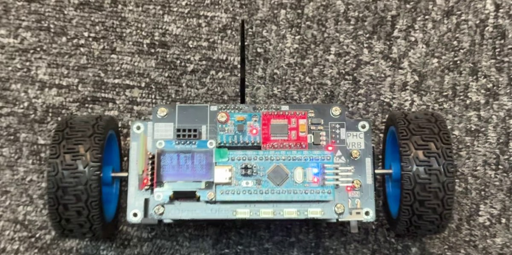
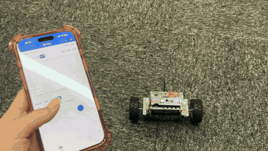
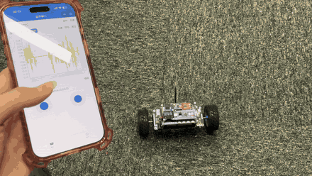
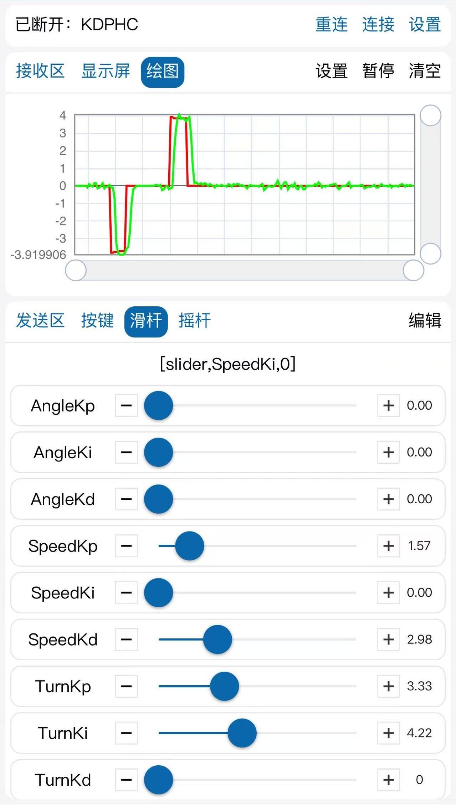

# Balance Car PID: Learning Project

**English** | [简体中文](README.zh-CN.md)

My work from following a two-wheel self-balancing car tutorial on an STM32F103C8, built up in five stages from basic drivers to angle, speed and turn control.

> **This is not original work.** The code is based on the balance car tutorial by [Jiangxie Technology (江协科技)](https://jiangxiekeji.com). In each stage, about 97% to 99% of the code lines match the tutorial source, ignoring comments and whitespace. The [changes from the tutorial](#changes-from-the-tutorial) section lists what differs.

## Demo



The car stays upright on carpet and responds to joystick commands from a phone over Bluetooth.

| Forward and backward | Turning |
|---|---|
|  |  |

▶ [Watch the full 34-second video](docs/media/demo.mp4) (sound removed)

### Turn loop tuning

The phone plots the turn target and the measured speed difference while the gains are adjusted with sliders. The measured value follows both steps of about ±4 with a short delay. The TurnKp of 3.33 and TurnKi of 4.22 on screen are the values in the stage 05 code.



## Control structure

Stage 05 runs three PID loops from a timer interrupt:

```text
Speed target -> Speed PID (50 ms) -> Angle PID (10 ms) -> Average PWM --+
                                                                        +-> Motors
Turn target  -> Turn PID  (50 ms) -------------------> PWM difference --+
```

- **Tilt angle:** a complementary filter combines the MPU6050 accelerometer and gyroscope readings.
- **Speed and turn feedback:** wheel encoders provide the average speed and the speed difference.
- **Tuning:** PID gains and joystick targets arrive over the Bluetooth serial link, and live values appear on the OLED.
- **Tilt cutoff:** the motors stop when the tilt passes ±50°.

## Stages

| Folder | What it adds |
|---|---|
| [`01-basic-drivers`](stages/01-basic-drivers) | OLED, buttons, motors, encoders, MPU6050 and serial drivers |
| [`02-complementary-filter`](stages/02-complementary-filter) | Tilt angle from a complementary filter |
| [`03-angle-loop`](stages/03-angle-loop) | Angle PID loop for standing upright |
| [`04-speed-loop`](stages/04-speed-loop) | Speed PID loop for moving forward and backward |
| [`05-turn-loop`](stages/05-turn-loop) | Turn PID loop for steering |

Each stage is a separate Keil MDK project. Open `Project.uvprojx` in its folder.

## Changes from the tutorial

Compared with the same stage of the tutorial source, stage 05 has these functional differences:

| Area | Tutorial | This repository |
|---|---|---|
| Integral term | Always accumulates when Ki is not zero | Accumulates only while the output is below its limits |
| Angle PID | Kp 3, Ki 0.1 | Kp 2.5, Ki 0 |
| Speed PID | Kp 2, Ki 0.05, output ±20 | Kp 5.71, Ki 0.11, output ±5 |
| Turn PID | Kp 4, Ki 3 | Kp 3.33, Ki 4.22 |
| Accelerometer angle offset | +0.5° | −2.7° |
| Gyroscope offset | Subtracts 16 from the raw reading | None |
| Joystick speed target | `LV / 25.0` | `LV / 150.0`, and the speed PID resets when the stick is centered |

The other differences are mostly formatting, naming and the order of statements. Stage 01 also uses its own test program in `main.c`.

## Build notes

Build outputs, personal Keil settings and the tutorial's slides, schematics and tools are not included.

## Credits and copyright

The tutorial code belongs to Jiangxie Technology. Its notes say the program is free and public and can be viewed, used, modified and applied to your own projects, and they also state "江协科技 版权所有" (all rights reserved by Jiangxie Technology). They do not explicitly mention republishing. For the latest official material, use the [Jiangxie Technology download page](https://jiangxiekeji.com/download.html).

The files in `Library` and `Start` come from STMicroelectronics and Arm and keep their original notices. This repository adds no open-source license.
