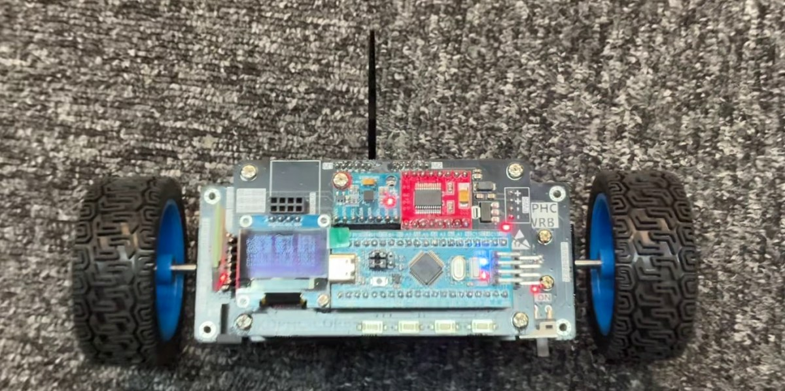
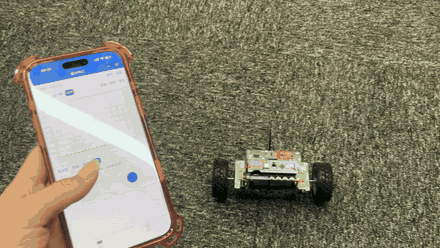
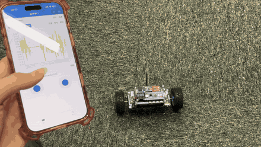
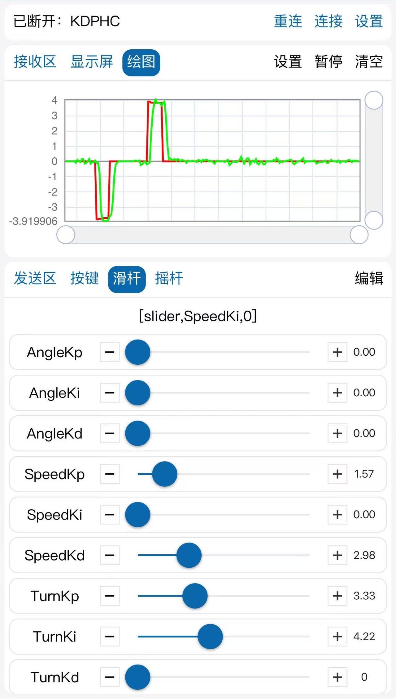

# 平衡车 PID：学习项目

[English](README.md) | **简体中文**

这是我跟着两轮自平衡小车教程，在 STM32F103C8 上完成的学习记录，分五个阶段，从基础驱动一直做到角度、速度和转向控制。

> **这不是原创项目。** 代码基于[江协科技](https://jiangxiekeji.com)的平衡车教程。忽略注释和空白后，每个阶段约 97%–99% 的代码行与教程源码相同。不同之处见[与教程的差异](#与教程的差异)。

## 演示



小车能在地毯上保持直立，并响应手机通过蓝牙发送的摇杆指令。

| 前进后退 | 转弯 |
|---|---|
|  |  |

▶ [观看 34 秒完整视频](docs/media/demo.mp4)（已去除声音）

### 转向环调参

手机一边用滑杆调参数，一边绘制转向目标值和实测速度差。实测值能跟上约 ±4 的两次阶跃，只有很短的延迟。屏幕上的 TurnKp 3.33 和 TurnKi 4.22 正是第五阶段代码里的数值。



## 控制结构

第五阶段在定时器中断里运行三个 PID 环：

```text
Speed target -> Speed PID (50 ms) -> Angle PID (10 ms) -> Average PWM --+
                                                                        +-> Motors
Turn target  -> Turn PID  (50 ms) -------------------> PWM difference --+
```

- **倾角：** 用互补滤波融合 MPU6050 的加速度计和陀螺仪数据。
- **速度和转向反馈：** 由车轮编码器得到平均速度和速度差。
- **调参：** 通过蓝牙串口发送 PID 参数和摇杆目标值，OLED 显示实时数据。
- **倾倒保护：** 倾角超过 ±50° 时电机停止。

## 阶段

| 文件夹 | 新增内容 |
|---|---|
| [`01-basic-drivers`](stages/01-basic-drivers) | OLED、按键、电机、编码器、MPU6050 和串口驱动 |
| [`02-complementary-filter`](stages/02-complementary-filter) | 用互补滤波计算倾角 |
| [`03-angle-loop`](stages/03-angle-loop) | 角度环，实现直立 |
| [`04-speed-loop`](stages/04-speed-loop) | 速度环，实现前进和后退 |
| [`05-turn-loop`](stages/05-turn-loop) | 转向环，实现转弯 |

每个阶段都是独立的 Keil MDK 工程，打开对应文件夹里的 `Project.uvprojx` 即可。

## 与教程的差异

与教程同阶段的源码相比，第五阶段有这些功能上的差异：

| 项目 | 教程 | 本仓库 |
|---|---|---|
| 积分项 | Ki 不为零时一直累加 | 只在输出未达到限幅时累加 |
| 角度环 | Kp 3、Ki 0.1 | Kp 2.5、Ki 0 |
| 速度环 | Kp 2、Ki 0.05、输出 ±20 | Kp 5.71、Ki 0.11、输出 ±5 |
| 转向环 | Kp 4、Ki 3 | Kp 3.33、Ki 4.22 |
| 加速度计角度偏移 | +0.5° | −2.7° |
| 陀螺仪偏移 | 原始值减 16 | 无 |
| 摇杆速度目标 | `LV / 25.0` | `LV / 150.0`，摇杆回中时重置速度环 |

其余差异主要是代码格式、命名和语句顺序。另外，第一阶段的 `main.c` 用的是我自己的测试程序。

## 构建说明

仓库不包含编译产物、个人 Keil 配置，以及教程的课件、原理图和工具软件。

## 来源与版权

教程代码归江协科技所有。教程说明写明程序完全免费公开，可以任意查看、使用和修改，并应用到自己的项目中，同时注明“江协科技 版权所有”。说明里没有明确提到公开转载。最新官方资料请到[江协科技资料下载页](https://jiangxiekeji.com/download.html)获取。

`Library` 和 `Start` 中的文件来自 STMicroelectronics 和 Arm，保留其原有声明。本仓库不附加开源许可。
